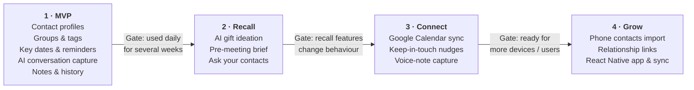
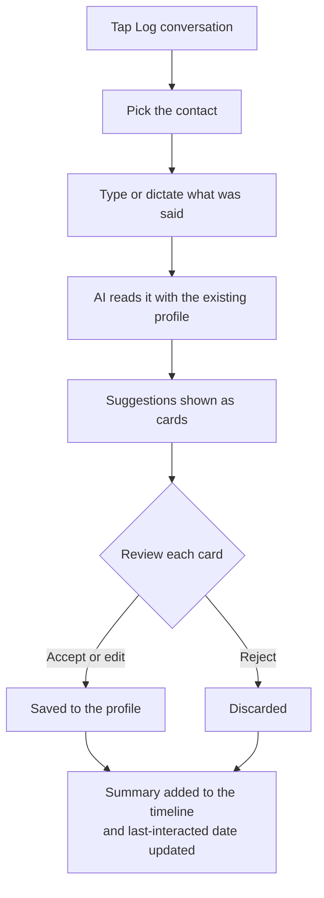

# Rapport

**A personal relationship memory app** — a contacts app that stores who people are, not just how to reach them.

> Working title. MVP brief, 2 Oct 2026 · Jack Francis Winterburn

Each contact holds their birthday, interests, habits, gift ideas and notes, plus a photo or avatar to anchor their face.

## Contents

- [Running the app](#running-the-app)
- [Overview](#overview)
- [Target user and design principles](#target-user-and-design-principles)
- [MVP scope](#mvp-scope)
- [MVP features](#mvp-features)
- [Feature roadmap](#feature-roadmap)
- [User flows (first draft)](#user-flows-first-draft)
- [Technical approach](#technical-approach)
- [Rough data model](#rough-data-model)
- [Privacy, ethics and risks](#privacy-ethics-and-risks)
- [Open questions and next steps](#open-questions-and-next-steps)

## Running the app

The MVP is built: a React + TypeScript PWA, a small Node API with Google sign-in, and AI conversation capture via Gemini Flash-Lite.

```
packages/core   UI-free domain logic shared by server, web and a future React Native app:
                models + validation (zod), date maths, search, AI-suggestion guards, CSV export, API client
apps/server     Hono API on Node 22 + SQLite (node:sqlite): Google OAuth, REST endpoints,
                Gemini capture, web-push reminders, data export/delete. Serves the built PWA in production.
apps/web        React 19 PWA (Vite, React Router, TanStack Query), design system in src/ui,
                service worker for offline reading and push notifications
docs/           design-system.md
```

### Local development

Requires Node 22.13+.

```bash
npm install
cp .env.example .env          # DEV_LOGIN=true lets you sign in without Google
npm run dev                   # API on :8787, app on http://localhost:5173
```

Add `GEMINI_API_KEY` to `.env` to turn on AI suggestions; without it you can still log conversations to the timeline.

```bash
npm run typecheck && npm test   # core + server tests (validation, dates, AI guards, OAuth, API, reminders)
npm run build                   # production build of the PWA
```

### Configuration

| Variable | Purpose |
| --- | --- |
| `GOOGLE_CLIENT_ID`, `GOOGLE_CLIENT_SECRET` | Google OAuth client (type "Web application"). Authorised redirect URI: `$APP_URL/auth/google/callback`. Required in production. |
| `ALLOWED_EMAILS` | Comma-separated emails allowed to sign in. Required in production. |
| `APP_URL` | Public origin, e.g. `https://rapport.example.com` |
| `GEMINI_API_KEY`, `GEMINI_MODEL` | AI capture. Defaults to `gemini-3.1-flash-lite`; any Flash-Lite model ID works. |
| `AI_MONTHLY_TOKEN_LIMIT` | Hard monthly cap on tokens per user (default 2,000,000) |
| `VAPID_*` | Web push keys (optional; generated and stored on first run if unset) |
| `DATABASE_PATH`, `TZ`, `PORT` | Storage, reminder time zone (reminders go out from 9am), port |

See [`.env.example`](.env.example) for the full list.

### Deploying

One container serves both the API and the PWA:

```bash
docker build -t rapport .
docker run -p 8787:8787 -v rapport-data:/data --env-file .env -e NODE_ENV=production rapport
```

Put it behind HTTPS (service workers, push and secure cookies require it). The SQLite database lives in `/data`; back up that volume, or use Settings → Export regularly.

### Decisions taken for the MVP

- **Storage:** hosted backend with SQLite, not local-first. Google sign-in needs a server, the server can send reminders when the app is closed, and data survives a lost phone. Offline reading comes from the service worker caching API responses.
- **Auth:** Google OAuth 2.0 (authorisation code + PKCE), restricted to `ALLOWED_EMAILS`. Sessions are httpOnly cookies; only a hash of the session id is stored. Every query is scoped to the signed-in user.
- **AI:** Gemini Flash-Lite with structured JSON output, called only from the server. Only the conversation text, the contact's name and their non-private details are sent: never contact details, photos or private notes. Suggestions are then checked in code before they're shown: each must quote what you wrote (`evidence`), sensitive topics are dropped, and duplicates of existing facts are dropped. Nothing is saved until you accept it.
- **Voice input:** browser dictation (Web Speech API) where available, plus the phone keyboard's microphone everywhere.
- **Design:** Notion-style surfaces with Todoist-style lists. See [docs/design-system.md](docs/design-system.md) or `/design-system` in the app.

## Overview

**The problem.** It is hard to remember the details that make people feel noticed: a friend's new hobby, a colleague's kid's name, what someone hinted they wanted for their birthday. Standard contacts apps store phone numbers and emails, so those details end up scattered across memory, notes apps and chat history, or lost.

**The idea.** Keep one structured profile per person, and use AI to cut the effort of filling and using it. Describe a conversation in a sentence or two, and the AI proposes what is worth remembering. The result is better conversations, better gifts and no missed birthdays.

**Scope of this document.** This README covers the MVP only: a small, sharp first version built for a single user (the author), with later ideas parked in a roadmap.

## Target user and design principles

The first and only MVP user is the author, who wants to remember people's interests and details across both personal and professional relationships. Building for one real user keeps the scope honest: every feature has to earn its place in daily use.

- **Capture must take seconds.** If logging a conversation is slow, it will not get done. Every flow is judged by how fast it is on a phone.
- **AI suggests, the user decides.** AI never writes to a profile on its own. It proposes changes and the user approves or rejects each one.
- **Friends and family are first-class.** The app is not a sales CRM. Language, layout and defaults suit personal relationships as much as professional ones.
- **Recall beats storage.** The test of success is whether the right detail surfaces when it is needed, not how much is stored.
- **Private by default.** Contacts are personal data about people who have not signed up, so the app collects the minimum and keeps it under the user's control.
- **Portable by design.** Logic and UI structure should carry over to a future React Native app with as little rework as possible.

## MVP scope

The MVP is a responsive PWA with a React frontend that proves one thesis: **does keeping structured notes on people, with AI help, actually make you better at remembering them?** Anything that does not test that thesis waits.

| Area | In the MVP | Deferred |
| --- | --- | --- |
| Contacts | Manual creation and editing; no phone contacts import | Native contacts import and duplicate merging |
| Profile | Photo or avatar, key dates, interests, habits, gift ideas, notes, contact details | Relationship links between contacts, life-event timeline |
| Organisation | Groups and tags, search, basic filters | Smart lists, saved filters |
| AI | Conversation capture with approve/reject | Gift ideation, pre-meeting brief, natural-language search |
| Reminders | In-app upcoming dates; notifications where the PWA supports them | Google Calendar sync, keep-in-touch cadences |
| Imports | None | Instagram and LinkedIn profile import (screenshot or shared text) |
| Platform | Responsive PWA, single user | React Native app, multi-device sync, sharing |

**Success looks like** the author using it after real conversations for several weeks, and finding that the stored details change what they say or give. Specific measures can be set once the first build exists.

## MVP features

Five features make up the MVP. Conversation capture is the one that differs from an ordinary contacts app, so it gets the most detail.

### 1. Contact profiles

- Name, nickname, photo or generated avatar (initials or illustrated), and how you know them
- Contact details: phone, email, address, social handles as plain text fields
- Structured fields: birthday, other key dates (anniversary, start date), interests, habits and preferences, gift ideas, free-form notes
- A "last interacted" date, set manually or by a conversation capture

### 2. Groups and tags

- Groups for broad context (Family, Friends, Work) and free-form tags for detail ("climbing", "met at conference")
- A contact can belong to several groups and carry many tags
- Filter the contact list by group or tag, and search by name or any field

### 3. Key dates and reminders

- An upcoming-dates view showing the next birthdays and key dates, soonest first
- Optional reminders at a chosen lead time (for example a week before, to leave time to buy a gift)
- Web push notifications where the browser and device allow; the in-app view is the fallback

### 4. AI conversation capture

- The user types or dictates a short description of a conversation and picks the contact
- The AI reads it alongside the existing profile and proposes structured updates: new interests, habits, gift ideas, key dates, a follow-up note
- Each suggestion is shown as a card the user can accept, edit or reject; nothing is saved until approved
- Approved items are saved to the profile, and the conversation summary is kept as a dated entry in the contact's history
- Sensitive categories (health, religion, relationships, finances) are not inferred, and the AI only suggests what the user actually wrote

### 5. Notes and history

- A dated timeline per contact: conversation captures and manual notes in one place
- Quick note entry from the contact page

### Basic requirements

- Works well on a phone screen first, then scales up to desktop
- Installable to the home screen, loads quickly and works offline for reading profiles
- Export all data (JSON or CSV) and delete everything, from the start

## Feature roadmap

After the MVP, the ideas below are suggested in three phases, ordered so that each builds on the data the one before it collects.



The table below lists every idea with what it does. The diagram shows only the headline features of each phase.

| Phase | Feature | What it does |
| --- | --- | --- |
| 2 · Recall | AI gift ideation | Suggests gifts from a contact's interests, past gifts, budget and occasion |
| 2 · Recall | Pre-meeting brief | A one-screen summary before a catch-up: last conversation, open threads, what they care about |
| 2 · Recall | Ask your contacts | Natural-language search, such as "who do I know who likes climbing?" |
| 2 · Recall | Face and name quiz | Spaced-repetition flashcards for new contacts, useful at a new job or event |
| 2 · Recall | Gift log | Records gifts given and received, to avoid repeats |
| 2 · Recall | Life-event timeline | Tracks events such as a new job or a house move, with a prompt to acknowledge them |
| 3 · Connect | Google Calendar sync | Adds birthdays and key dates to the calendar as reminders |
| 3 · Connect | Keep-in-touch nudges | Per-contact or per-group reminders, such as "it has been three months since you spoke" |
| 3 · Connect | Follow-up tracking | Turns "I said I would send him that article" into a tracked promise |
| 3 · Connect | Voice-note capture | Dictate after a conversation, transcribed and parsed like typed capture |
| 3 · Connect | Share-sheet and card capture | Send text from other apps, or scan a business card, into a contact |
| 3 · Connect | Social profile import | Create or update a contact from a shared Instagram or LinkedIn profile (screenshot or pasted text) |
| 4 · Grow | Phone contacts import | Bring in native contacts, with duplicate merging |
| 4 · Grow | Relationship links | "Introduced by", "works with" and "partner of" connections between contacts |
| 4 · Grow | Personal and professional modes | Separate views so work context does not clutter family context, plus an extra lock for private notes |
| 4 · Grow | React Native app and sync | A native mobile app and multi-device sync built on the shared core |

## User flows (first draft)

Five flows cover the MVP, across five screens: **contact list**, **contact profile**, **add or edit contact**, **capture review**, and **upcoming dates**. These are first drafts to react to before any wireframes.

### 1. First run

1. Open the PWA and sign in, if the app has a backend.
2. Choose whether to install it to the home screen and allow notifications.
3. Land on an empty contact list with a clear "Add your first contact" button.

### 2. Add a contact

1. Tap **Add contact** on the contact list.
2. Enter a name, the only required field.
3. Optionally add a photo or avatar, how you know them, groups and tags.
4. Optionally add a birthday and key dates, interests, habits, gift ideas and contact details. Anything skipped can be filled in later.
5. Save, and the new profile opens.

### 3. Log a conversation

This is the flow that makes the app more than an address book. The user describes a chat, the AI proposes updates, and the user approves or rejects each one.



The only decision point is the review step: accepted or edited suggestions are saved to the profile, and rejected ones are discarded.

### 4. Check upcoming dates

1. Open **Upcoming dates** to see the next birthdays and key dates, soonest first.
2. A reminder arrives at the chosen lead time, as a push notification where supported.
3. Tap a date or reminder to open that contact's profile, where gift ideas and notes are one scroll away.

### 5. Prepare before meeting someone

1. Search for the contact by name, or browse by group or tag.
2. Open the profile and read the top details: interests, habits, gift ideas and the latest timeline entries.
3. After the catch-up, tap **Log conversation** to capture what was said while it is fresh.

## Technical approach

The MVP is a React and TypeScript PWA, structured so that the logic can move to React Native later and only the UI layer needs rewriting. The choices below are suggestions to confirm, not decisions.

| Concern | Suggested approach | Why |
| --- | --- | --- |
| Frontend | React with TypeScript, built with Vite | Fast tooling and typed models shared with a future mobile app |
| PWA | Web app manifest plus a service worker (for example via Workbox) | Installable, offline reading, push notifications |
| React Native portability | Keep domain models, validation, state and API calls in a UI-free core module; keep UI components thin | Only the view layer is rewritten for mobile |
| Styling and components | A component approach that maps to native later; avoid heavy reliance on DOM-only libraries in shared logic | Reduces rework |
| Data storage | **Open decision:** local-first (IndexedDB) or a hosted backend with a database | Local-first is simplest for one user; a backend is needed for multi-device sync and server-side reminders |
| Photos | Resize and compress on the client before storing | Keeps storage and load times small |
| AI integration | A small server-side function that calls the model API, never the browser directly | Keeps API keys private and lets you control what is sent |
| AI output format | Ask the model for structured output (a list of proposed field updates) and validate it before showing suggestions | Makes the approve/reject cards reliable |
| Reminders | In-app upcoming-dates view first; web push second | Web push on iPhone only works once the PWA is installed to the home screen |
| Auth | Simple single-user sign-in, if a backend is used | Real multi-user auth can wait |

**Portability note.** A common route is a monorepo with a shared package for models and logic, a web app on top, and a mobile app added later. Whether to share UI as well (for example with React Native Web) can be decided when the mobile app starts.

## Rough data model

Six entities cover the MVP. Field lists are a starting point and will change once the first screens exist.

| Entity | Key fields | Notes |
| --- | --- | --- |
| Contact | id, name, nickname, photo or avatar, how we know each other, phone, email, address, social handles, last interacted, created, updated | The central record |
| Fact | id, contact, type (interest, habit, preference, gift idea, other), text, source (manual or AI capture), created | One row per remembered detail, so each can be edited, approved or removed separately |
| KeyDate | id, contact, label (birthday, anniversary, other), date, repeats yearly, reminder lead time | Drives the upcoming-dates view and reminders |
| Group | id, name | Broad context such as Family, Friends, Work |
| Tag | id, name | Free-form labels; linked to contacts through a join |
| Interaction | id, contact, date, summary text, linked facts | A conversation capture or manual note on the contact's timeline |

Two design choices are worth confirming. Storing facts as separate rows rather than one notes blob makes AI suggestions easy to approve one by one, and lets later features (gift ideas, search, briefs) work from structured data. Keeping a `source` on each fact also shows later which details the user entered and which the AI proposed.

## Privacy, ethics and risks

The app stores personal information about people who never agreed to be in it, so privacy is a design requirement from the first build. This is a planning summary, not legal advice; check the rules that apply before any public release.

- **Personal use now, public product later.** For a single user keeping personal records, data protection duties are light. If the app is ever released to others, the provider becomes responsible for processing that data (UK GDPR would apply), which means a privacy policy, a lawful basis, data minimisation, and export and delete tools. Building export and delete into the MVP makes that step easier.
- **Sensitive details.** Health, religion, relationships and similar categories deserve extra care. The AI should not infer them, and the user should be able to mark any note as private.
- **AI data handling.** Conversation text is sent to a model provider. Send only what the feature needs, check the provider's retention and training terms, and tell the user plainly what is sent.
- **The "creepy" line.** An app that profiles people can feel manipulative. Framing and wording should centre on remembering what matters to people you care about. Human approval of every AI suggestion keeps the user in control.
- **Social media imports.** Instagram and LinkedIn do not offer open access to arbitrary profile data, and scraping can breach their terms. The deferred import feature should be designed around what the user shares themselves (a screenshot or pasted text), and the platform terms checked before building it.
- **Data loss.** If data is only on one device, a lost phone means lost contacts. Backup or sync needs deciding early, alongside the storage choice.

## Open questions and next steps

The biggest open decision is where data lives, because it affects reminders, sync and the AI function.

**Open questions**

- [x] Local-first (IndexedDB) or a hosted backend with a database for the MVP? **Hosted backend (SQLite), with offline reading via the service worker.**
- [x] Which AI model and provider for conversation capture, and what is the monthly cost limit? **Gemini Flash-Lite; limit set by `AI_MONTHLY_TOKEN_LIMIT`.**
- [ ] Should the app have a proper name, and a visual identity (colours, avatar style)?
- [ ] Which facts should be treated as private by default?
- [x] Should conversation capture accept voice input in the MVP, or only typed text? **Typed text plus browser dictation where supported.**

**Suggested next steps**

- [x] Confirm the data storage decision
- [ ] Sketch wireframes for the five core screens: contact list, contact profile, add or edit contact, conversation capture review, upcoming dates
- [ ] Write the conversation-capture prompt and test it on a handful of real conversation descriptions before building any UI
- [x] Set up the repository (React, TypeScript, PWA shell) with a UI-free core module for models and logic
- [x] Build the contact profile and list, then key dates, then conversation capture
- [ ] Use it for a few weeks and review against the success measure in the MVP scope

The MVP work is tracked as [GitHub issues](../../issues), grouped into milestone epics.
